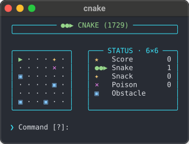
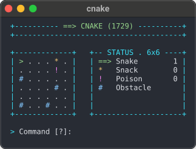

# Cnake

*Cnake* is a simple, text-based snake game for the terminal, written in C.

| Unicode (default) | ASCII (`--ascii`) |
| :---: | :---: |
|  |  |


**Rules**

The game is won when the entire available board space is filled. The status
panel tracks that goal as the number of filled tiles out of the board total.
Eating snacks increases the snake's length, while poison shortens it. Colliding
with obstacles, running into the snake's own body, or consuming poison at the
minimum length is fatal. The tail moves out of the way in the same step, so
moving onto it is safe, except while the snake grows after `c`. A move straight
back onto the body segment behind the head is ignored, so a single mistyped key
does not end the game.

**Controls**

```
+---------- CONTROLS ----------+
|           k ^                |
|       h <     > l            |
|           j v                |
|                              |
|   also: arrow keys, wasd     |
+------------------------------+
| ? Show help                  |
| q Quit                       |
+------- DEVELOPER KEYS -------+
| v Toggle debug view          |
| c Add five segments          |
+------------------------------+
```

## Build, Run, and Install

Requires `Make` and a C11 compiler on a POSIX-compatible system.

```bash
make
./cnake
```
Display all options with:

```bash
./cnake --help
```

This prints:

```
Usage: ./cnake [board-size] [options]

Play Cnake with a board size from 4 to 10 (default 5).

Options:
  --help        Display this help and exit
  --version     Display the version and exit
  --ascii       Use pure ASCII characters for all terminal output
  --monochrome  Disable ANSI text styling and use default terminal colors
  --seed UINT   Reproduce a game with an unsigned integer seed
```

Options and the board size can appear in any order.

ANSI text styling is disabled automatically when the output stream is not a
terminal, and when the `NO_COLOR` environment variable is set to a non-empty
value. `--monochrome` disables it unconditionally.

The seed reproduces the same board and subsequent random tile placements when
using the same C library implementation. A seeded game replays the same board on
every retry; without `--seed`, each retry starts from a new board.

After quitting, the result of the last round and the command that replays its
board remain on the normal screen:

```
 Game over: hit an obstacle. Score 15, length 2, filled 7/25.
 Replay this board: cnake 5 --seed 7
```

---

Install to `/usr/local/bin` by default:

```bash
sudo make install
```

Set `PREFIX` to install elsewhere without elevated permissions:

```bash
make install PREFIX="$HOME/.local"
```

Use the same prefix to uninstall:

```bash
make uninstall PREFIX="$HOME/.local"
```

Packagers can stage an installation by setting `DESTDIR`.

Remove the compiled binary and `build/` artifacts with `make clean`.

## Tests

Build the game and every test binary, run the test suites and check the
command-line interface:

```bash
make check
```

Repeat the same checks against a build instrumented with AddressSanitizer and
UndefinedBehaviorSanitizer, in a separate object directory:

```bash
make check-sanitize
```

Both targets accept the usual variables, for example `make check CC=clang
CFLAGS="-O2 -Werror"`. Continuous integration runs `make check` with GCC and
Clang on Linux and with Clang on macOS, `make check-sanitize` on Linux, and
verifies the formatting with `clang-format`.

## License

Copyright 2026 Aaron Dettmann

Licensed under the Apache License, Version 2.0. \
See the [LICENSE](LICENSE) file for details.
