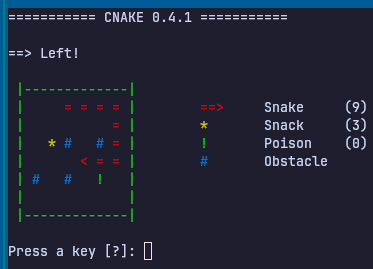

# Cnake

*Cnake* is a simple text-based snake game written in C.



## Build and Run

Requires GCC and Make.

```bash
make
./cnake
```

Remove the compiled binary with `make clean`.

## License

Copyright 2026 Aaron Dettmann

Licensed under the Apache License, Version 2.0.
See the [LICENSE](LICENSE) file for details.
